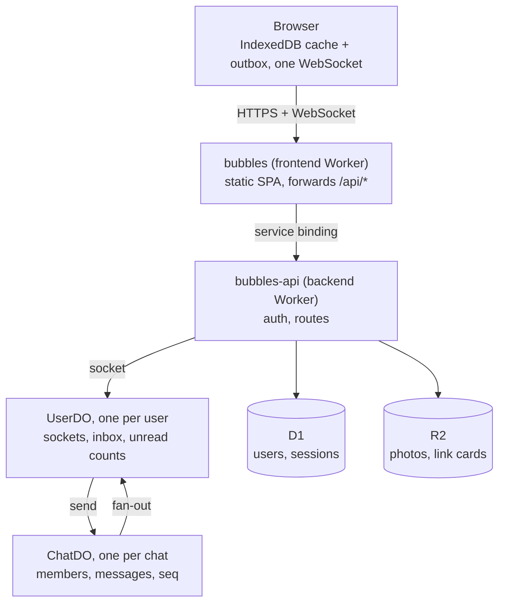
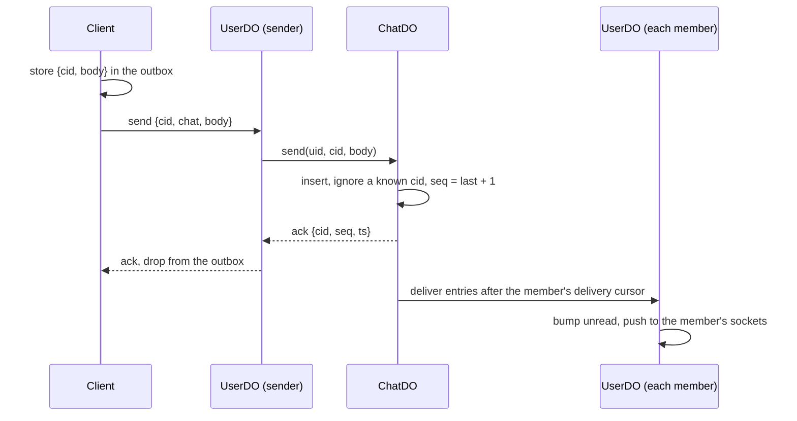

# Bubbles

A real-time chat app that runs entirely on Cloudflare. Each chat is one Durable Object, each user is another, and each device holds one WebSocket. The client keeps a local copy of everything in IndexedDB, so the app opens from cache before the network answers and keeps working offline.

Live at [bubbles.sudoanmol.workers.dev](https://bubbles.sudoanmol.workers.dev).

## What it proves

| Claim                                  | Proof                                                                                          | Status           |
| -------------------------------------- | ---------------------------------------------------------------------------------------------- | ---------------- |
| Exactly-once, gap-free delivery        | `pnpm chaos`: drops sockets and redeploys mid-run, then checks every client's log is identical | Passes locally   |
| Works offline                          | Airplane mode, send 5 messages, reconnect: all 5 arrive in order                               | Checked by hand  |
| Small                                  | JS fetched to open a chat: 171 KB gzip, against a 175 KB budget                                | Measured by hand |
| Read on one device, cleared everywhere | Read state goes through the user's UserDO to every device they have                            | Built            |
| Fast, measured live                    | A public `/status` page with p50, p95 and p99 latency                                          | Phase 6          |
| Cheap to run                           | A cost model: dollars per million messages, and the bill with no traffic                       | Phase 6          |

## Features

- Direct messages and group chats
- Group admins, renaming, adding and removing people
- Replies, edits, deletes and emoji reactions
- Photos
- Link previews
- Read receipts and unread counts, synced across your devices
- Typing indicators and online status
- Profiles with a name, username and photo, plus a generated avatar if you don't add one
- Dark mode
- Works offline: messages you send go out when you're back online

Still to come: voice messages, search, push notifications, a public latency page and calls. See [Roadmap](#roadmap).

## Stack

| Layer       | Choice                                                                                  |
| ----------- | --------------------------------------------------------------------------------------- |
| Frontend    | React 19 with the React Compiler, TanStack Router (SPA), Tailwind v4, shadcn on Base UI |
| Client data | TanStack Query, written through to IndexedDB with `idb`                                 |
| Socket      | `partysocket` (reconnects with backoff)                                                 |
| API         | Hono on Cloudflare Workers                                                              |
| Protocol    | Valibot schemas shared by both sides (`backend/src/protocol.ts`)                        |
| Auth        | Better Auth on D1 through Drizzle                                                       |
| Storage     | Durable Object SQLite (chats, inboxes), D1 (users), R2 (photos, link cards)             |
| Tooling     | pnpm, oxlint, oxfmt, Knip, husky + lint-staged, Vitest in the Workers runtime           |

## Architecture



- **One public origin, private API.** The frontend Worker serves the app and forwards `/api/*` to the backend over a service binding. The backend has no public URL, so cookie auth needs no CORS.
- **One socket per device.** The user's UserDO holds it. Clients never open a socket per chat.
- **ChatDO is the source of truth for a chat.** A Durable Object handles one request at a time, so every message gets the next `seq` with no locks. It then fans the message out to each member's UserDO, which pushes it to their devices.



- **Exactly once, in order.** The client names each message with a ULID and stores it in the outbox before sending. ChatDO ignores a ULID it has already seen, so retries are harmless. The client tracks the last unbroken `seq` per chat and fetches anything it missed.
- **Edits, reactions and group changes are log entries too**, each with its own `seq`, so the same gap repair covers them.

The full design, including the delivery protocol and data model, is in [AGENTS.md](AGENTS.md).

## Core files

| File                                  | What it does                                                                                            |
| ------------------------------------- | ------------------------------------------------------------------------------------------------------- |
| `backend/src/durable-objects/chat.ts` | ChatDO: assigns `seq`, deduplicates sends, stores the log, fans out to members                          |
| `backend/src/durable-objects/user.ts` | UserDO: holds the user's sockets, inbox and unread counts, presence                                     |
| `backend/src/protocol.ts`             | The wire protocol and the rules both sides share (`applyPatch`, `nextPreview`, `nextRead`, `nextGroup`) |
| `backend/src/auth.ts`                 | Better Auth config                                                                                      |
| `backend/src/limits.ts`               | Rate limits counted in Durable Objects                                                                  |
| `backend/src/unfurl.ts`               | Link cards from Open Graph tags, cached in R2                                                           |
| `frontend/src/lib/socket.ts`          | The socket and the outbox: stores, sends and replays frames in order                                    |
| `frontend/src/lib/store.ts`           | The IndexedDB store, one database per account                                                           |
| `frontend/src/lib/log.ts`             | Pure rules for merging the log with pending changes                                                     |
| `frontend/src/lib/api.ts`             | HTTP calls and chat sync (gap repair)                                                                   |
| `frontend/src/worker.ts`              | The frontend Worker: assets first, `/api/*` to the backend                                              |
| `tests/chaos.ts`                      | Chaos test: scripted clients, dropped sockets and a redeploy mid-run                                    |
| `tests/rules.ts`                      | The pure log and inbox rules under every arrival order                                                  |
| `backend/test/`                       | Durable Objects in the Workers runtime: fan-out, groups, reads, limits, media                           |

The full layout is in [AGENTS.md](AGENTS.md).

## Local setup

You need Node 24 and pnpm 11. You don't need a Cloudflare account to run it locally: Wrangler runs D1, R2 and the Durable Objects on your machine.

```sh
git clone git@github.com:sudoanmol/bubbles.git
cd bubbles
pnpm install
cp .env.example .env
```

Fill in `.env`:

- `BETTER_AUTH_SECRET`: generate one with `openssl rand -base64 32`.
- `BETTER_AUTH_URL`: leave it as `http://localhost:3100`.
- `GOOGLE_CLIENT_ID` and `GOOGLE_CLIENT_SECRET`: optional, only for Google sign-in. Create a Web OAuth client in the Google Cloud console with the redirect URI `http://localhost:3100/api/auth/callback/google`.

Then start both Workers:

```sh
pnpm dev
```

The app runs on [localhost:3100](http://localhost:3100) and the API on :8790. `pnpm dev` applies pending D1 migrations first. To test two accounts side by side, open `http://localhost:3100/api/dev/login/<username>` in a second browser profile. That route only exists locally.

| Command                 | What it does                                                                                                                                                  |
| ----------------------- | ------------------------------------------------------------------------------------------------------------------------------------------------------------- |
| `pnpm test`             | Rule, store and Durable Object tests                                                                                                                          |
| `pnpm chaos`            | Chaos test against the running dev server: kills sockets and redeploys mid-run, then checks every client's log is identical (`REDEPLOY=0` skips the redeploy) |
| `pnpm typecheck`        | TypeScript across every package                                                                                                                               |
| `pnpm lint`, `pnpm fmt` | oxlint and oxfmt (also run on commit)                                                                                                                         |
| `pnpm knip`             | Unused files, exports and dependencies                                                                                                                        |
| `pnpm build`            | Production build                                                                                                                                              |

## Deployment

Production runs on Cloudflare Workers. Every push to `main` runs the checks in GitHub Actions, and when they pass it deploys: D1 migrations, then the backend, then the frontend. The frontend's service binding needs `bubbles-api` to exist, so the backend always goes first.

### First deploy

1. Sign in: `pnpm -C backend exec wrangler login`.
2. Create the database and bucket, then put the database id in `backend/wrangler.jsonc`:
   ```sh
   cd backend
   pnpm exec wrangler d1 create bubbles
   pnpm exec wrangler r2 bucket create bubbles-chat
   ```
3. Set the backend secrets (in `backend/`): `pnpm exec wrangler secret put <KEY>` for `BETTER_AUTH_SECRET`, `BETTER_AUTH_URL` (your production origin), `GOOGLE_CLIENT_ID` and `GOOGLE_CLIENT_SECRET`.
4. Add `<origin>/api/auth/callback/google` as a redirect URI on the Google OAuth client.
5. Deploy from the root: `pnpm run deploy`.

### Deploys on push

1. Create an API token in the Cloudflare dashboard (Manage account → Account API tokens) from the "Edit Cloudflare Workers" template, and add D1: Edit and Workers R2 Storage: Edit.
2. Add both repository secrets:
   ```sh
   gh secret set CLOUDFLARE_API_TOKEN    # paste the token when prompted
   pnpm -C backend exec wrangler whoami  # prints your account id
   gh secret set CLOUDFLARE_ACCOUNT_ID --body <account id>
   ```

After that, pushing to `main` deploys. Pull requests run the checks without deploying. Secrets set with `wrangler secret put` stay in place across deploys.

## Performance budget

| Metric                                    | Target                         | Measured          |
| ----------------------------------------- | ------------------------------ | ----------------- |
| JS on the first load of a chat            | < 175 KB gzip                  | 171 KB            |
| Time to first chat visible, warm cache    | < 150 ms                       | Not yet           |
| Send to ack, p50, same region             | < 50 ms                        | Not yet           |
| Send to peer receive, p99, same continent | < 150 ms                       | Not yet           |
| Messages lost or duplicated under chaos   | 0                              | 0 (local dev)     |
| Inbox load                                | 1 Durable Object read, < 30 ms | 1 read, not timed |

CI enforces none of these yet; the latency numbers come with sampling into Analytics Engine in phase 6.

## Roadmap

| Phase | Scope                                                                      | Status              |
| ----- | -------------------------------------------------------------------------- | ------------------- |
| 0     | Foundations: workspace, auth, CI                                           | Done                |
| 1     | DMs end to end                                                             | Done                |
| 2     | Local-first: IndexedDB, outbox, gap repair, chaos test                     | Done                |
| 3     | Groups, replies, edits, reactions, receipts, typing, presence, rate limits | Done                |
| 4     | Photos, link cards, profiles, avatars; voice messages                      | Voice messages left |
| 5     | Search (FTS5), PWA, web push, per-chat mute                                | Not started         |
| 6     | Latency sampling, public `/status` page, load tests, cost model            | Not started         |
| 7     | 1:1 voice and video calls over WebRTC                                      | Not started         |
